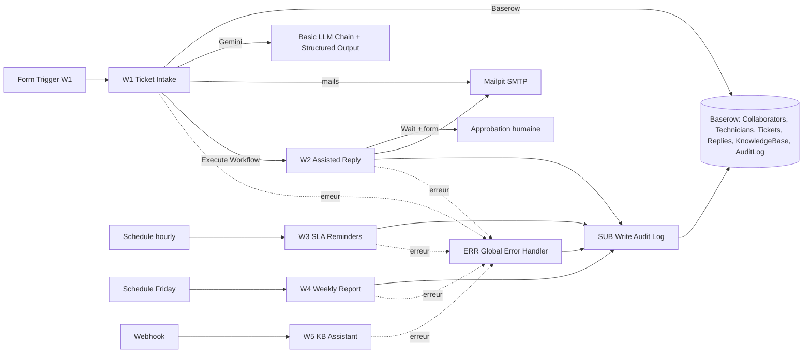

# Architecture

## Vue d'ensemble

## Choix et justifications

- **Basic LLM Chain, pas d'agent** : classification, brouillon, rapport et
  réponse KB sont des appels déterministes sans appel d'outil dynamique ; un agent
  n'apporterait que de l'imprévisibilité et du coût. La sortie de classification
  et de réponse est contrainte par un Structured Output Parser (JSON Schema avec
  `required`, `enum`, bornes de `confidence`).
- **HTTP Request + API Baserow** plutôt que le nœud Baserow : même résultat, mais
  filtres, pagination et `user_field_names` maîtrisés avec un seul credential
  Header Auth.
- **Sous-workflow d'audit** : une seule définition de l'écriture dans `AuditLog`,
  appelée par quatre workflows ; contrat documenté dans sa description
  (entrées typées, sortie `{ ok, audit_id, action, ticket_id }`).
- **Stratégie `onError`** : arrêt par défaut sur les écritures et l'envoi au
  demandeur (risque de données incohérentes) ; `continueRegularOutput` pour les
  notifications (mail technicien, accusé de réception, alerte P1, alerte erreur) ;
  `continueErrorOutput` pour les appels IA (boucle de retry puis branche de repli).
- **Retry** : l'appel IA (W1, W2, W4, W5) a un vrai backoff exponentiel. La
  sortie d'erreur de la chaîne LLM alimente une boucle `Is Retry Allowed For …`
  → `Wait Before Retrying …` → nouvel essai. L'attente vaut
  `AI_BACKOFF_BASE_SECONDS × 2^essai` (5 s, puis 10 s) et le nombre de relances
  est `AI_MAX_RETRIES` (2, donc 3 essais). Si tout échoue (429, quota dépassé,
  indisponibilité), la branche de repli prend le relais : `manual_review` et
  audit `ai_error`. Cette boucle a été vérifiée sur un vrai 429 de Gemini.
  Les appels HTTP et SMTP utilisent le « Retry On Fail » natif de n8n (3 essais,
  2 s), dont le délai est constant.
- **Valeurs paramétrables** : catégories (`AI_CATEGORIES`), priorités
  (`AI_PRIORITIES`, `URGENT_PRIORITY`), valeurs de repli (`FALLBACK_CATEGORY`,
  `FALLBACK_PRIORITY`), tag `MANUAL_REVIEW_TAG`, seuil de confiance, SLA, période
  du rapport (`REPORT_PERIOD_DAYS`) et adresses e-mail passent par `$env` ; le
  JSON Schema du Structured Output Parser et le prompt de W1 sont construits à
  partir de ces variables.
- **Pas de nœud Code** : W4 calcule ses statistiques avec les nœuds natifs
  `Split Out` → `Filter` → `Aggregate` → `Edit Fields`.
- **Traçabilité** : `$execution.id` est inscrit dans le champ `details` de
  chaque ligne d'audit (W1 à W4, workflow d'erreur) pour retrouver l'exécution
  n8n concernée ; W3 y ajoute `$itemIndex` (position du ticket traité).
- **Idempotence** : W1 met à jour le ticket ouvert du même demandeur, même sujet,
  même jour ; W3 ignore les tickets déjà `late` ou `closed`.
- **Mailpit** : boîte SMTP locale, aucun mail ne quitte la machine.

## Services locaux

| Service | Image | Adresse locale | Persistance |
| --- | --- | --- | --- |
| Baserow | `baserow/baserow:2.4.1` | `http://localhost:8081` | Volume Docker `baserow_data` |
| n8n | `docker.n8n.io/n8nio/n8n:2.45.6` | `http://localhost:5678` | Volume Docker `n8n_data` |
| Mailpit | `axllent/mailpit:v1.21` | `http://localhost:8025` (SMTP `mailpit:1025`) | Aucune |

Les ports sont liés à `127.0.0.1`. Baserow utilise son image tout-en-un
officielle pour ce prototype local. n8n utilise son stockage SQLite intégré et
son volume persistant ; cela évite d'ajouter un service de base de données avant
que le besoin du projet ne le justifie.

Les appels d'n8n vers Baserow utilisent l'adresse interne Docker
`http://baserow:80`, et non `localhost` (qui désigne le conteneur n8n lui-même).
La variable `BASEROW_EXTRA_PUBLIC_URLS=http://baserow` du service Baserow
autorise cette adresse sans en-tête `Host` particulier.

## Modèle Baserow à créer

Les six tables requises par le sujet :

1. `Collaborators`
2. `Technicians`
3. `Tickets`
4. `Replies`
5. `KnowledgeBase`
6. `AuditLog`

Les champs, relations et règles détaillés sont définis dans
[SCHEMA.md](SCHEMA.md). Ne place aucune donnée réelle de collaborateurs dans le
jeu de démonstration.
Le jeu fictif rejouable demandé par le sujet se trouve dans
[seed/seed-baserow.mjs](../seed/seed-baserow.mjs) ; il ne supprime aucune ligne.

## Workflows

- `W1` (`W1-ticket-intake.json`) : formulaire, normalisation, classification
  structurée, affectation, mails. Lance W2 sans l'attendre.
- `W2` : recherche documentaire, brouillon de réponse et approbation humaine.
- `W3` : surveillance SLA (toutes les heures), mails et statut `late`.
- `W4` : rapport hebdomadaire (vendredi 17h) par mail et dans `AuditLog`.
- `W5` : assistant de base de connaissances (bonus), webhook
  `POST /webhook/kb-assistant` avec `{"question": "..."}`; réponse JSON avec
  `answer` et `sources` (articles cités).
- `SUB - Write Audit Log` : sous-workflow réutilisé par W2, W3, W4 et le
  workflow d'erreur ; il écrit une ligne dans `AuditLog`.
- `ERR - Global Error Handler` : workflow d'erreur global (Error Trigger),
  rattaché à tous les workflows ; il journalise dans `AuditLog` et alerte
  `ERROR_EMAIL`.
